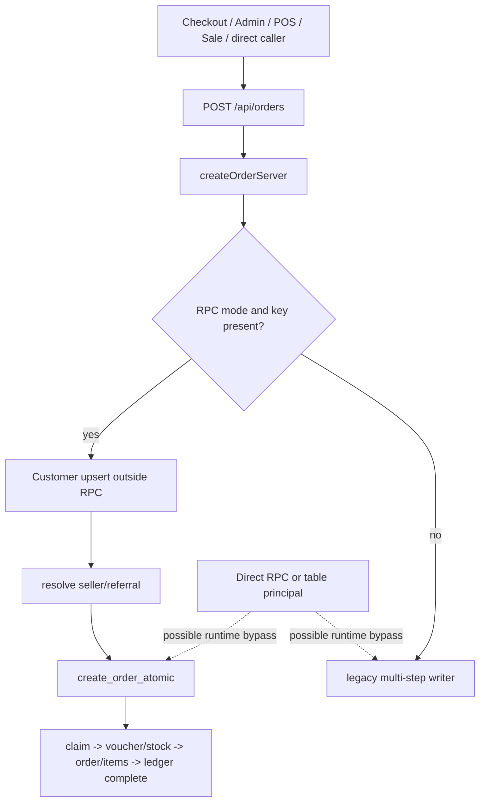
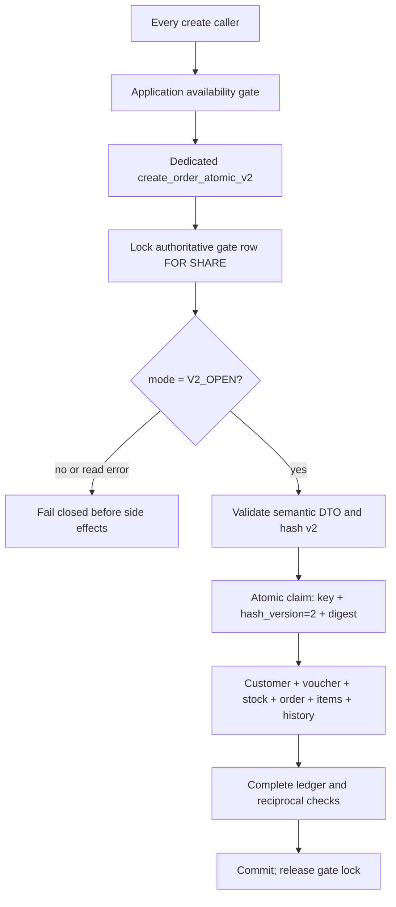

# P0-A3 — Idempotency Hash v2 Design Review

## 1. Status and authority

| Item | Status |
|---|---|
| P0-A3 design review | **READY FOR IMPLEMENTATION PLANNING** |
| P0-A3 implementation/cutover | **OPEN / BLOCKED** |
| Implementation | **NO-GO** |
| Production cutover | **NO-GO** |
| Real PostgreSQL concurrency verification | **Not verified** |

This document closes the source-level design review sufficiently to begin a separately authorized, file-level implementation plan. It does not authorize source, test, migration, database, deployment, or Production changes. Design closure records the intended mechanism; it does not supply business approval, operator evidence, implementation proof, or runtime verification.

Evidence labels used here:

- **Source-observed:** present in the current working tree at HEAD `1c51af625a575a41733d59b29cc9be9ae0892c60`. The working tree is dirty, so this is not evidence that the code is committed or deployed.
- **Design requirement:** required behavior for a future approved implementation.
- **Operator evidence required:** cannot be established from repository contents.
- **Unverified:** no sufficient runtime or real-database evidence exists.

The idempotency migrations and related service/test files referenced below are currently untracked. Their presence in the repository does not prove that any database has applied them.

## 2. Current source observations

### 2.1 Request and writer paths

| Path/object | Current behavior and first relevant side effect | Idempotency/gate observation |
|---|---|---|
| `POST /api/orders` in [`src/app/api/orders/route.ts`](../../src/app/api/orders/route.ts) | Reads a header or body key and calls `createOrderServer`. The route itself does not enforce a mandatory key. | A caller can omit the key and reach the legacy writer. No P0-A3 gate is present. |
| `createOrderServer` in [`src/lib/services/orderService.ts`](../../src/lib/services/orderService.ts) | Selects RPC mode only when `GIEOMO_ORDER_WRITER` is not `legacy` **and** a key is present. The no-key branch remains multi-step legacy. | Environment selection and optional keys permit legacy behavior. This is not a cutover gate. |
| `createOrderViaAtomicRpc` in `orderService.ts` | Upserts the customer before calling the atomic RPC, then resolves seller/referral data and calls `create_order_atomic`. | Customer writes occur outside the RPC transaction and before its ledger claim. |
| `saveNewOrder` in [`src/lib/data/orderStore.ts`](../../src/lib/data/orderStore.ts) | Builds a request, obtains an attempt key, and posts to `/api/orders`. Admin, POS, and sale screens use this shared client path. | Current first-party callers generally supply a key, but the server does not require one. Client behavior cannot secure direct HTTP/RPC/DB access. |
| Checkout in [`src/app/checkout/page.tsx`](../../src/app/checkout/page.tsx) | Persists an attempt key and retries the same request through `/api/orders`. | Browser storage is useful for retry continuity but cannot classify a database row as v1 or v2. |
| Migration 015 in [`supabase/migrations/015_order_idempotency.sql`](../../supabase/migrations/015_order_idempotency.sql) | Defines `order_idempotency`, a primary key on `idempotency_key`, and a partial unique index on `orders.idempotency_key`. | The ledger has no `hash_version`. `NULL` cannot be interpreted safely as v1. |
| `create_order_atomic` in [`supabase/migrations/016_create_order_atomic.sql`](../../supabase/migrations/016_create_order_atomic.sql) | In one PostgreSQL transaction it inserts the claim, resolves lines, locks/reserves voucher, deducts variant stock, inserts order/items/history, and completes the ledger. | It accepts requests without a key, contains no version or cutover gate, and grants execute to `service_role`. Effective runtime ACLs remain unverified. |
| Direct table/RPC access | Repository migrations describe RLS and selected function ACLs. | Repository files cannot prove live owners, role memberships, grants, default privileges, service-role use, triggers, or external clients. |
| Cron, queues, workers, scripts, and external integrations | No repository evidence found that proves a complete runtime writer inventory. | **Operator evidence required.** Absence from source search is not proof that none exist. |

Known create callers include checkout, admin order creation, POS, and sale order creation. They converge on `/api/orders` in the current working tree. The public route and database privileges remain possible bypass boundaries until runtime evidence and database enforcement establish otherwise.

### 2.2 Current v1 hash weaknesses

[`src/lib/services/orderRequestHash.ts`](../../src/lib/services/orderRequestHash.ts) currently:

- clamps/defaults quantity into `1..99`;
- merges duplicate `(kind, id)` lines and clamps the aggregate;
- omits district, buyer/recipient names, buyer email, customer note, and introducer information;
- chooses only one of combo, variant, or product identity;
- hashes seller/referral fields but the writer later substitutes database-resolved seller/source/introducer values.

Consequences include a known collision between duplicate quantities `99 + 1` and a single quantity `99`, and unchanged hashes when omitted semantic fields such as district change. These are v1 limitations; existing **confirmed v1** keys retain this behavior for replay compatibility.

### 2.3 Current ledger and test limitations

- Ledger reads currently collapse database read errors and genuinely missing rows into `null` in `getByIdempotencyKey`. V2 requires a typed result.
- `orders.idempotency_key` uniqueness prevents two committed orders with the same non-null key, but it does not classify hash versions or prove reciprocal ledger integrity.
- The existing atomic RPC has a useful transaction boundary for voucher, stock, order, items, and ledger, but customer upsert occurs before the RPC in TypeScript.
- [`tests/atomicOrderPg.integration.test.ts`](../../tests/atomicOrderPg.integration.test.ts) is conditional on an optional `pg` module and `ATOMIC_PG_URL`. A skip is not verification.
- Current fixtures insert `products.sku`, although migration 001 defines `sku` on `product_variants`, not `products`.
- The current variant fingerprint expectation asserts `kind = product` and the parent product ID, while migration 016 builds `kind = variant` and the variant ID.
- The current two-worker test rolls both transactions back while expecting `created + existing`. A rolled-back claim/order cannot be treated as committed existing state; after rollback, another worker may claim and create.

## 3. Creation flow and required gate location

Current flow:



Required v2 flow:



The authoritative gate must be enforced inside the database transaction before the first side effect. An application-only flag is insufficient because direct RPCs, old artifacts, service-role access, and table writes could bypass it.

## 4. Design closure and remaining gates

The original ten blockers are reclassified below. “Design decided” means this document specifies the intended contract; it does not mean code exists or the mechanism has passed a test.

| # | Original blocker | Classification after this review | Remaining gate |
|---:|---|---|---|
| 1 | Gate serialization and a real drain barrier | **DESIGN DECIDED** for participating v2 writers; **OPERATOR EVIDENCE REQUIRED** for bypassing writers | Implement and review the lock protocol; prove ingress closure and independent drain. |
| 2 | Reciprocal order-ledger invariants and atomic transaction boundaries | **DESIGN DECIDED** | Migration/RPC review and real PostgreSQL commit/rollback tests. |
| 3 | Effective privileges, RPC ownership, and bypass removal | **DESIGN DECIDED** enforcement boundary; **OPERATOR EVIDENCE REQUIRED** for live state | Live catalog/role evidence and denial tests. |
| 4 | Canonical line identity for valid variant payloads | **DESIGN DECIDED** | Deterministic vectors plus TypeScript/PostgreSQL parity tests. |
| 5 | Classification of legacy NULL-version rows | **DESIGN DECIDED** procedure; **OPERATOR EVIDENCE REQUIRED** per row | Closed-gate manifest and reviewer-approved evidence; ambiguous rows remain NULL. |
| 6 | Quantity limits and complete semantic DTO | DTO rules are **DESIGN DECIDED** except limits; **BUSINESS DECISION REQUIRED** | Approve per-line maximum, aggregate quantity maximum, and maximum line count if any. |
| 7 | Typed `found | missing | read_error` handling | **DESIGN DECIDED** | Implement and exercise every branch. |
| 8 | Orphans, expired leases, and ambiguous legacy requests | **DESIGN DECIDED** fail-closed behavior | Implement reconciliation states and verify no replacement creation. |
| 9 | PostgreSQL concurrency and rollback verification | **OPERATOR EVIDENCE REQUIRED** | Approve an isolated target and obtain non-skipped results. |
| 10 | Artifact identity, writer drain, and dual-reader rollback | **DESIGN DECIDED** runbook; **OPERATOR EVIDENCE REQUIRED** | Identify all artifacts/writers and rehearse rollback/forward fix. |

Compact decision register:

| State | Decisions/items |
|---|---|
| **DESIGN DECIDED** | Version dispatch; concurrency claim protocol; gate modes/transitions/lock order; reciprocal v2 integrity mechanism; immutable fields; canonical DTO/bytes; retry/replay behavior; ACL enforcement boundary; cutover and rollback runbook. |
| **BUSINESS DECISION REQUIRED** | Maximum quantity per line, maximum aggregate quantity per order, and whether a maximum number of lines is required. No implementation may substitute `99` or another value. |
| **OPERATOR EVIDENCE REQUIRED** | Artifact/writer inventory, ingress/drain proof, row-classification evidence, effective live ACL/catalog state, isolated PostgreSQL target/results, monitoring, and rollback/forward-fix ownership. |

## 5. Approved hash v2 contract

### 5.1 Approved decisions

1. **Maximum quantity remains pending business approval.** Do not assume `99`. Invalid quantities are rejected, never clamped or silently defaulted. After approval, TypeScript validation, API validation, and PostgreSQL validation must accept exactly the same per-line and aggregate range.
2. **Cart order is non-semantic.** Canonically sort normalized line tuples, preserve duplicate-line multiplicity, and never merge duplicates. Two lines with quantities `1` and `2` remain distinct from one line with quantity `3`.
3. **Seller, referral, and introducer hashing uses normalized raw input values.** Hash construction must not silently substitute database-resolved member IDs, referral codes, source types, names, or introducer strings.
4. **Approval is documentation-only.** No implementation, migration, test change, database action, or cutover is authorized.

### 5.2 One semantic DTO

The future implementation validates once and produces one `OrderSemanticV2` value. The database-authoritative v2 canonicalizer and writer consume that same value inside `create_order_atomic_v2`; the writer must not normalize or resolve a second interpretation after hashing. TypeScript may mirror validation for early errors, but PostgreSQL remains authoritative and shared vectors must prove parity.

Logical shape:

```text
OrderSemanticV2
  buyer_name: string
  buyer_phone: string
  buyer_email: string | null
  recipient_name: string
  recipient_phone: string
  delivery_type: home_delivery | pickup_point | self_pickup | member_delivery
  address_detail: string | null
  district: string | null
  province: string | null
  customer_note: string | null
  voucher_code: string | null
  referral_code_raw: string | null
  seller_id_raw: uuid | null
  introducer_info_raw: string | null
  lines: CanonicalLineV2[]

ValidatedLineInputV2
  one primary shape: product_id alone; variant_id with optional product_id assertion; or combo_id alone
  quantity

CanonicalLineV2
  kind: product | variant | combo
  primary_id: lowercase uuid
  quantity: positive safe integer
```

Semantic input classification:

| Field | Classification and required behavior |
|---|---|
| Product, variant, or combo identity | Order-semantic. V2 accepts canonical UUID identities only; slugs and mixed identifier formats are rejected at this boundary. Exactly one kind is selected, except that a variant may also carry its parent assertion. |
| Variant parent `product_id` | Validation-only assertion. `variant_id` alone and `variant_id` plus the matching parent produce the same canonical line. After the claim is acquired, the locked variant row must prove the assertion before any business write; mismatch rolls back the whole transaction including the claim. |
| Quantity | Order-semantic JSON number that must be a positive safe integer. No string coercion, flooring, default, or clamp. Maximum and aggregate bounds remain pending. |
| Duplicate lines | Order-semantic multiplicity. Keep every tuple. Never aggregate for hashing, even if stock locking later aggregates demand. |
| Buyer/recipient names and phones | Order-semantic because they determine customer/recipient data. Recipient fields may fall back to normalized buyer fields only when absent; explicit values are normalized independently. |
| Buyer email | Order-semantic because customer data may change. |
| Address detail, district, province | Order-semantic and represented separately. A district change changes the digest. Home delivery requires non-null address detail and province; district may be null until a separate business rule requires it. |
| Delivery type | Order-semantic, required, and enum-validated. V2 has no silent default. |
| Customer note | Order-semantic. Changes after normalization change the digest. |
| Voucher code | Order-semantic raw code after normalization; price and eligibility remain server-derived. |
| Raw referral code, raw seller ID, raw introducer information | Order-semantic raw inputs. Hash all three before database resolution. |
| Server-resolved seller, shipper, source, or introducer values | Server-derived. Excluded because normalized raw inputs are present. Resolution happens once inside the transaction. A later database change cannot alter replay of a completed attempt. |
| Prices, costs, stock, shipping settings, voucher calculation, totals | Server-derived and excluded. A completed retry returns stored results rather than recalculating them. |
| Order ID/code, status, timestamps, proof token | Server-derived and excluded. |

Other validation rules are fixed:

- `buyer_name` and `buyer_phone` are required;
- absent recipient name/phone deterministically copy the normalized buyer name/phone; present recipient values must be valid and non-empty;
- buyer and recipient phone normalize to 9–11 ASCII digits under the rule below;
- `items` must be a non-empty array; any maximum line count is a pending business limit;
- every line must match exactly one recognized primary shape: product-only, variant with optional parent-product assertion, or combo-only;
- all UUIDs must parse as UUIDs and serialize lowercase;
- all strings must contain valid Unicode scalar values; reject unpaired surrogate input;
- quantity must satisfy `Number.isSafeInteger(quantity)` semantics and `quantity >= 1`, plus the future approved maxima;
- after removing documented transport fields such as the idempotency key, the v2 DTO boundary rejects unknown creation fields. No unsupported field may be silently ignored and later affect writing.

### 5.3 Exact normalization and null rules

The normalization primitive `trim-edge` removes only these ASCII edge code points: tab `U+0009`, LF `U+000A`, vertical tab `U+000B`, form feed `U+000C`, CR `U+000D`, and space `U+0020`. It does not normalize Unicode composition, internal whitespace, case, punctuation, or line endings. The writer persists the normalized value used by the digest.

Field rules:

- names, address components, customer note, and introducer text: apply `trim-edge`; preserve all remaining code points and case;
- buyer email: `trim-edge`, then ASCII lowercase;
- voucher/referral codes: `trim-edge`, require one or more characters matching ASCII `[A-Za-z0-9_-]+`, then ASCII uppercase;
- seller and line UUIDs: `trim-edge`, validate UUID, then lowercase canonical UUID text;
- phone: `trim-edge`, remove only ASCII space, tab, `+`, `-`, `.`, `(`, and `)`; reject every other non-ASCII-digit character; require 9–11 remaining digits;
- optional fields `buyer_email`, `address_detail`, `district`, `province`, `customer_note`, `voucher_code`, `referral_code_raw`, `seller_id_raw`, and `introducer_info_raw`: missing, JSON `null`, and a string empty after their field normalization all become canonical `null` **only because the v2 writer also writes/uses them as no value**;
- required strings: missing, JSON `null`, wrong type, or empty after normalization are invalid;
- explicit recipient values do not collapse to absence; absence alone invokes the documented buyer fallback;
- JSON boolean, object, array, or number supplied for a string field is invalid; no `String(value)` coercion is allowed.

Shared deterministic vectors must cover every field and, for every optional field, prove the intended missing/`null`/empty equivalence. They must also prove that whitespace or case changes remain distinct wherever normalization does not explicitly collapse them.

### 5.4 Exact line sorting and byte serialization

For each validated line:

1. Determine the identity shape without JavaScript truthiness precedence.
2. Validate UUIDs and quantity.
3. Retain any variant parent assertion for later locked validation but exclude it from canonical identity; construct `[kind_ordinal, primary_id, quantity]`, where product = `0`, variant = `1`, and combo = `2`.
4. After the claim is acquired, validate the assertion against the variant row locked in the global order. Rejecting a mismatch rolls back the claim and all transaction work.
5. Sort by numeric `kind_ordinal`, then by the lowercase UUID's ASCII bytes, then by numeric quantity ascending.
6. Retain identical tuples as repeated array elements. Do not merge or deduplicate.

The canonical payload is a positional JSON array in this exact order:

```text
[
  buyer_name,
  buyer_phone,
  buyer_email,
  recipient_name,
  recipient_phone,
  delivery_type,
  address_detail,
  district,
  province,
  customer_note,
  voucher_code,
  referral_code_raw,
  seller_id_raw,
  introducer_info_raw,
  sorted_lines
]
```

Serialization rules:

- compact RFC 8259 JSON with no insignificant whitespace;
- strings use the ECMAScript `JSON.stringify` escape mapping: quotation mark as `\"`, reverse solidus as `\\`, backspace/form-feed/LF/CR/tab as `\b`, `\f`, `\n`, `\r`, `\t`, and every other `U+0000..U+001F` control as lowercase `\u00xx`; solidus is not escaped and all other scalar values remain unescaped UTF-8;
- `null` is the JSON token `null`;
- quantity is base-10 integer text with no sign, fraction, exponent, or leading zero except the impossible value zero is already rejected;
- line tuples are arrays in the fixed order above;
- no object-key ordering is involved in the hashed representation.

The digest is lowercase hexadecimal SHA-256 of:

```text
UTF8("gieomo-order-request:v2\n" + canonical_json)
```

The authoritative PostgreSQL canonicalizer must produce the bytes and digest used for the claim. A mirrored TypeScript implementation is permitted for validation/testing only; shared golden vectors must compare its canonical bytes and digest with PostgreSQL before cutover.

Required deterministic distinctions include:

- `[quantity 99, quantity 1]` differs from `[quantity 99]` and from `[quantity 100]` if `100` is approved;
- `[quantity 1, quantity 2]` differs from `[quantity 3]`;
- reordering the same multiset of lines does not change canonical bytes;
- identical duplicate tuples remain repeated;
- variant-only and variant-plus-matching-parent produce the same line tuple; mismatched parent is rejected;
- every normalized semantic field changes the digest when its canonical value changes;
- seller/referral/introducer values are the normalized raw values, never database substitutions.

## 6. Version and ledger contract

### 6.1 Proposed additive metadata

A future separately approved migration should add:

```sql
hash_version SMALLINT NULL
CHECK (hash_version IS NULL OR hash_version IN (1, 2))
```

This is a design sketch, not executable authorization. It must use a named constraint and an immutability mechanism that rejects changes after a non-null version is assigned. Version and `request_hash` must be written atomically in the initial claim. V2 must never insert an unversioned claim.

The migration must not backfill `NULL` automatically. In particular, `created_at`, `updated_at`, request timing, client storage, or an assumed deployment time is not classification evidence.

### 6.2 Required behavior matrix

| Observed state | Required behavior |
|---|---|
| Confirmed v1 row (`hash_version = 1`) | Compute and compare v1 only. Preserve legacy replay semantics and its documented collision weakness. Never fall back to v2 for the same key. |
| V2 row (`hash_version = 2`) | Compute and compare v2 only. No legacy fallback. Digest mismatch is a conflict. |
| `hash_version IS NULL` | Unknown/ambiguous. Fail closed and route to an explicit reconciliation/classification process. Never silently treat it as v1. |
| Ledger read result `found` | Branch only on the explicit version and state. |
| Ledger read result `missing` | Continue only after a successful, transactionally consistent check proves no order exists for the key; a new v2 claim must then be atomic with that decision. |
| Ledger read result `read_error` | Return a retryable operational failure and create nothing. Never interpret it as missing. |
| Order has key but ledger is missing | Orphan/reconciliation state. Do not create a tombstone automatically and do not create another order. |
| Completed ledger has missing/mismatched order | Reconciliation state. Do not replay an unverified response or create a replacement. |
| Active lease | Return processing/in-progress. Do not steal it. |
| Expired lease | Fail closed to reconciliation. Expiry alone is not proof that no side effect committed; no automatic takeover. |
| Lost response after commit | Retry with the same key/version/digest must verify and replay the committed result. |
| In-flight legacy claim during cutover | Do not classify until legacy writers and their transactions are independently proven drained. Otherwise leave `NULL`. |

Ledger access must return a typed union such as `found | missing | read_error`, including the underlying safe diagnostic category without exposing credentials or personal data.

### 6.3 Reciprocal order-ledger invariants

For every committed v2 order:

- exactly one ledger row has the same idempotency key;
- that row has `hash_version = 2`, the v2 digest, `status = completed`, and `order_id` equal to the order;
- the order points back through the same idempotency key;
- no completed v2 ledger row points to a missing or different order;
- claim, all business effects, order creation, and ledger completion commit or roll back together.

PostgreSQL `CHECK` constraints cannot safely express cross-table reciprocity, and a normal foreign key cannot express the conditional rule “only completed v2 rows.” The feasible design is a pair of `DEFERRABLE INITIALLY DEFERRED` constraint triggers plus ordinary uniqueness/FK support:

1. A ledger constraint trigger runs for inserts or changes to `hash_version`, `status`, `order_id`, or `idempotency_key`. At transaction end, every `hash_version = 2 AND status = 'completed'` row must have a non-null `order_id`, and exactly one order must match both that ID and key.
2. An order constraint trigger runs for new keyed orders or changes to `order_id`/`idempotency_key`. At transaction end, an order created while the locked gate is `V2_OPEN` must have exactly one completed version-2 ledger row matching both ID and key.
3. Gate-aware `BEFORE INSERT` enforcement triggers on new order rows and ledger claims first lock the singleton gate row `FOR SHARE`. `LEGACY_OPEN` permits the explicitly retained legacy behavior; `CLOSED` rejects every new order/claim; `V2_OPEN` requires a non-null key, `hash_version = 2`, and execution under the dedicated no-login v2 function-owner role. ACLs remain the primary boundary for the other protected writes; the triggers are defense in depth.
4. Existing v1/NULL rows are not bulk-validated or rewritten. The constraint triggers apply to new v2 rows and to mutations of protected identity columns. Ordinary status/payment/delivery updates on a legacy order do not reclassify it.

Immutability rules:

- `idempotency_key`, a non-null `hash_version`, `request_hash`, and `created_at` never change after claim insertion;
- the only version assignment permitted after insertion is controlled `NULL -> 1` classification while the gate is `CLOSED`, by a dedicated operator function using an approved key manifest; `NULL -> 2`, `1 -> 2`, `2 -> 1`, and non-null -> `NULL` are forbidden;
- after a v2 row is completed, `status`, `order_id`, `items_fingerprint`, `expected_item_count`, and `response_json` are immutable; reconciliation may set only dedicated operational flags/diagnostics such as `needs_recon` and append an audit/incident record, without rewriting the completed proof; replay fails closed while that flag is set;
- a v2 order's `order_id` and `idempotency_key` are immutable;
- deleting a v2 ledger or its order is denied. The existing `ON DELETE SET NULL` behavior may remain for legacy rows but must not weaken v2 protection;
- only separately defined operational metadata that cannot alter replay identity may be updated.

Constraint triggers validate transaction-end state. Application checks improve errors but are not integrity enforcement. Superusers, table owners, disabled triggers, and roles able to assume the function-owner role remain privileged bypasses and therefore belong in the operator evidence boundary.

### 6.4 Concurrent claim protocol and guarantee boundary

`create_order_atomic_v2` uses PostgreSQL `READ COMMITTED` semantics and claims with one statement equivalent to:

```sql
INSERT INTO order_idempotency (idempotency_key, hash_version, request_hash, ...)
VALUES (:key, 2, :digest, ...)
ON CONFLICT (idempotency_key) DO NOTHING
RETURNING idempotency_key;
```

The unique primary key is the serialization point:

1. If no row conflicts, the transaction owns the new claim and continues.
2. If another transaction has an uncommitted claim for the same key, PostgreSQL waits for that transaction. The waiter does not inspect or label the uncommitted row as an existing order.
3. If the first transaction commits, the insert returns no row. The waiter performs a post-conflict reread in a new `READ COMMITTED` statement snapshot and dispatches on the committed row's version, digest, and status.
4. If the first transaction rolls back, PostgreSQL may complete the waiting insert successfully. That waiter becomes the claimant and creates the order in its own transaction. A rolled-back order is never replayed.
5. If conflict resolution or reread produces a serialization/deadlock/transport error, or the committed row cannot be read, the request fails closed and retries with the same key. It does not issue a replacement key.

Same key and same v2 digest:

- committed completed winner: verify the reciprocal order/ledger proof and replay the stored response;
- committed active in-progress row: return processing without takeover; a durable v2 in-progress row is anomalous because the v2 claim normally commits with the order, but processing remains the safe immediate response;
- failed/reconciliation/expired state: follow the fail-closed state matrix; do not create again.

Same key and different digest:

- if the first claimant commits, return `hash_mismatch` after the committed reread and create no effects;
- if the first claimant rolls back, the waiter may acquire the key with its own digest and proceed because no first order or claim committed.

The guarantee is **at most one committed database order and one committed set of transactional database effects per idempotency key**, subject to the enforced unique key, gate, ACLs, triggers, and single transaction. This is not a promise of exactly-once email, webhook, analytics, logging, or other external side effects. Any required external delivery needs a transactional outbox plus consumer idempotency; otherwise it remains outside P0-A3's database guarantee.

## 7. Authoritative gate design

### 7.1 Modes

| Mode | Meaning |
|---|---|
| `LEGACY_OPEN` | Preparation state. Legacy traffic may still exist. V2 creation must not open. No row classification may rely on time alone. |
| `CLOSED` | All create/retry paths fail closed before side effects. Used for drain, classification, cutover, and emergency closure. |
| `V2_OPEN` | Only the approved v2 RPC may create/retry orders. It must write version and digest atomically. Legacy/no-key writers are rejected. |

The authoritative mode must be stored in a single database control row protected by constraints. Failure to read or lock that row means closed behavior.

Allowed transitions are deliberately narrow:

- `LEGACY_OPEN -> CLOSED`: required preparation transition;
- `CLOSED -> V2_OPEN`: allowed only when every implementation, business, test, and operator prerequisite is verified;
- `V2_OPEN -> CLOSED`: emergency closure or planned maintenance;
- `CLOSED -> LEGACY_OPEN`: allowed only before the first v2 claim has ever committed, with explicit operator proof and approval;
- direct `LEGACY_OPEN -> V2_OPEN` and every `V2_OPEN -> LEGACY_OPEN` transition are forbidden.

A transition runs in one database transaction, locks the singleton row `FOR UPDATE`, validates the current/next pair and requires an operator evidence-bundle reference, updates the mode, and commits. The database can validate the state transition and reference format; it cannot prove external deployment/drain evidence, which remains an operator approval gate. Any lock timeout, validation failure, catalog/read error, or uncertain commit leaves callers behaving as closed until an authoritative reread proves the mode.

### 7.2 Lock protocol

- `create_order_atomic_v2` locks the control row `FOR SHARE` before any customer, voucher, stock, order, item, history, or ledger effect and holds the lock until transaction end.
- A transition to `CLOSED` obtains the same row `FOR UPDATE`. It waits for participating v2 transactions to finish and prevents new participating transactions from crossing the gate.
- Legacy writers that do not implement this lock protocol are **not** drained by the row lock. They must be stopped, blocked at ingress/ACL level, and verified independently.
- Gate state must be checked again through the authoritative locked row, not through process cache, environment variables, browser storage, or deployment timestamps.
- A downgrade from `V2_OPEN` to `LEGACY_OPEN` is forbidden. Emergency action transitions to `CLOSED`.

All v2 create transactions use this global lock order:

1. singleton gate row `FOR SHARE`;
2. idempotency-key claim/row;
3. customer natural-key row or uniqueness conflict resolution;
4. member/referral rows needed for deterministic resolution;
5. catalog rows in fixed type order `products -> product_variants -> combos -> combo_items`, with UUIDs ascending within each type;
6. voucher row, if any;
7. stock-bearing variant rows by ascending UUID (reuse an already-held variant lock rather than reacquiring in another order);
8. new order row;
9. order-item and history rows in canonical line order;
10. ledger completion row, already held from the claim.

Every future function that locks more than one of these shared resources must follow the same relative order or document why it cannot overlap. Deadlock detection remains possible; SQLSTATE `40P01`/serialization errors return a retryable same-key failure and never trigger a new key or partial compensation.

Emergency closure acquires the gate row `FOR UPDATE`, changes `V2_OPEN -> CLOSED`, closes ingress, and separately drains bypass-capable writers. Reopen to `V2_OPEN` requires an identified root cause, reconciled database invariants, the approved artifact on every instance, reviewed ACL/catalog state, successful focused PostgreSQL rehearsal, active monitoring, and named rollback/forward-fix ownership. Any unverified prerequisite forbids reopen.

### 7.3 Database enforcement and bypass closure

The future design requires:

- a dedicated `create_order_atomic_v2` function; do not replace the old function in place during mixed deployment;
- a dedicated no-login owner role for the v2 function, with no runtime role membership and only the table privileges required by the function;
- no direct table write privileges for runtime roles on orders, items, customer mutation used by create, voucher quota, variant stock, history, or the ledger;
- revoked runtime execute permission on old create RPCs before `V2_OPEN`;
- reviewed function owner, `SECURITY DEFINER` status, fixed safe `search_path`, body, and grants;
- database enforcement that rejects no-key and old-path order creation while `CLOSED` or `V2_OPEN`;
- effective ACL/default-privilege/member-role verification from the live catalog, including privileged/service principals;
- trigger/function inventory proving no trigger or alternate function creates orders or performs relevant effects outside the approved path.

RLS alone is not sufficient for roles that bypass it, function owners, or security-definer functions. The required enforcement boundary is: runtime identities may invoke the reviewed v2 function, but cannot assume its owner, write protected tables directly, execute old create functions, disable triggers, or change the gate. Superuser/break-glass access is an operator-controlled exception that must be inventoried and absent from normal application credentials.

## 8. Transaction design for `create_order_atomic_v2`

One invocation of the dedicated RPC is one PostgreSQL transaction. The gate `FOR SHARE` lock is acquired in that transaction and cannot be released before its commit or rollback. The RPC must perform, in this order:

1. lock and validate the authoritative gate;
2. parse, normalize, and syntactically validate the semantic DTO, including quantity and line identity;
3. have the database-authoritative canonicalizer produce the canonical bytes and v2 digest;
4. read/claim the ledger with typed state and atomically store key, version `2`, and digest;
5. handle existing v1/v2/NULL states according to the version matrix;
6. create/update the customer as part of the same transaction;
7. resolve seller/referral/introducer from the already-hashed normalized raw values;
8. lock and validate product/variant/combo records in the global order, including any variant-parent assertion;
9. lock, validate, and reserve voucher quota;
10. deduct stock atomically;
11. insert order and order-item snapshots;
12. insert required history/audit data; failures must not be swallowed if that would violate the declared atomic contract;
13. complete the ledger with the order link, fingerprint, and replay response;
14. satisfy reciprocal deferred invariants and commit.

Any failure after the claim must roll back the claim and all listed effects. No compensating best-effort release is an acceptable substitute for the v2 transaction boundary.

The RPC must not perform network calls or other non-transactional external effects. If email, webhook, or notification delivery is required, it must enqueue a uniquely keyed transactional outbox row in the same transaction; delivery and consumer deduplication are separate guarantees.

## 9. Controlled migration and cutover sequence

Every step requires separate implementation and operator approval.

1. **Inventory and rehearsal:** establish all artifacts, writers, principals, RPCs, triggers, jobs, and an isolated PostgreSQL test target.
2. **Additive database preparation:** add nullable version metadata, the constrained gate row in `LEGACY_OPEN`, immutable-version enforcement, v2 RPC, and reciprocal constraints in a safe pre-validation form. Do not backfill versions.
3. **Deploy a dual-reader artifact:** it understands v1, v2, and NULL; honors all gate modes; fails closed on read error/orphan/ambiguity; and does not create v2 while the gate is not `V2_OPEN`.
4. **Prove artifact identity:** verify every active instance and traffic destination runs the approved dual-reader artifact. Detect and remove traffic to old artifacts.
5. **Stop legacy entry points:** close create ingress, stop cron/queues/workers/integrations, revoke old RPC/direct-write access, and prevent new old-writer work.
6. **Close the database gate:** acquire `FOR UPDATE`, transition to `CLOSED`, and keep create/retry unavailable.
7. **Drain:** prove no old create transaction, session, lock waiter, prepared transaction, job, or external writer remains. Gate locking drains participating writers only; old writers require independent evidence.
8. **Classify with evidence:** capture an auditable key-level manifest while closed. Assign version `1` only to rows proven to have been created by v1. Leave every uncertain row `NULL`. Never infer from timestamps.
9. **Reconcile structural anomalies:** orders with no ledger, ledgers with no/mismatched order, expired claims, and incomplete rows remain blocked until explicitly resolved. Do not auto-create or delete records.
10. **Verify schema/ACL/invariants:** inspect effective catalog state, function definitions, grants, owners, triggers, indexes, constraints, and role memberships.
11. **Open v2:** transition to `V2_OPEN` only after all acceptance gates pass. Re-enable only approved entry points.
12. **Observe:** monitor versionless claim attempts, old RPC/direct-write denials, hash mismatches, reconciliation states, duplicate-key conflicts, and replay failures.

Mixed-version deployment is safe only while old writers cannot create v2/unversioned claims and cannot serve create/retry traffic after `V2_OPEN`.

Each step produces an auditable evidence item containing operator, timestamp, target identity, artifact/schema identity, command or dashboard action category, redacted result, and reviewer. `V2_OPEN` is forbidden while any preceding prerequisite is failed, blocked, stale, or unverified. A documented procedure is not evidence that its step ran.

## 10. Rollback constraints

Rollback after v2 data exists means:

1. transition the gate from `V2_OPEN` to `CLOSED` using the serialized lock protocol;
2. stop create/retry ingress and drain participating and non-participating writers;
3. retain `hash_version`, v2 rows, gate metadata, ledger/order links, and evidence;
4. deploy only a verified dual-reader artifact that can safely read v1, v2, and NULL rows;
5. do not deploy a v1-only artifact, downgrade versions, rewrite v2 digests as v1, delete ledger rows, or reopen legacy/no-key writers;
6. prefer a reviewed forward fix; reopen only after the same evidence gates pass.

Database rollback that drops version/gate/invariant support is forbidden once any v2 claim may exist.

## 11. PostgreSQL test plan

### 11.1 Safe-target prerequisite

No PostgreSQL test may run until an operator positively identifies an isolated, disposable, non-Production target and confirms that its credentials, project/cluster identity, database name, network endpoint classification, and data policy are safe. The report must identify which migrations were applied without printing connection strings or credentials.

Cleanup must run in `finally`. Prefer per-test transactions and rollback. Tests that require committed rows for cross-connection visibility must use unique run-scoped identifiers and delete only those identifiers after assertions. A skipped test is **SKIP / NOT VERIFIED**, never PASS.

### 11.2 Required matrix

| Area | Minimum real-database assertion |
|---|---|
| Gate close serialization | A v2 writer holds `FOR SHARE`; closing waits on `FOR UPDATE`; after close, no new writer passes and existing participating work finishes deterministically. |
| Legacy drain | Old RPC/direct insert/no-key paths are denied after closure; operator evidence shows no old transaction remains. |
| Same key, same payload | Multiple concurrent connections produce exactly one committed order, one voucher reservation/stock effect, and deterministic replay of that order. |
| Same key, different payload | Exactly one payload may commit; competitors receive version-aware hash mismatch and create no effects. |
| Lost response after commit | Simulate a committed transaction with a lost client response; retry returns the committed order and does not recalculate or reapply quota/stock. |
| Rollback after customer operation | Inject failure after customer mutation begins; customer/order/items/ledger and all later effects roll back according to the declared contract. |
| Rollback after voucher reservation | Inject failure and prove quota, stock, order, items, history, and ledger are unchanged. |
| Rollback after stock operation | Inject failure and prove stock, voucher quota, customer/order data, history, and ledger are unchanged. |
| Commit visibility | One worker commits; a concurrent waiter observes/replays the committed result. Do not roll back the winning order before asserting `existing`. |
| Claim rollback | A claimant rolls back; another worker may then claim and succeed. No test asserts that the rolled-back order exists. |
| Version behavior | Confirmed v1 uses v1 only; v2 uses v2 only; NULL fails closed; no v2 fallback to v1. |
| Missing/read error/orphan | Distinguish missing from injected read error; an order without ledger and a completed ledger without order enter reconciliation without creation. |
| Leases | Active lease reports processing; expired lease does not transfer ownership automatically and enters the approved reconciliation path. |
| Reciprocal constraints | Invalid v2 order-only, ledger-only, mismatched-key, mismatched-order, and completed-with-null-link transactions fail at commit. |
| Direct bypass | Runtime principals cannot insert/update protected tables or execute old create RPCs; approved v2 execute succeeds only in the proper gate mode. |
| Dual-reader rollback | After a v2 row exists, close the gate and run the rollback artifact; it reads/replays safely and never writes v1 over v2. |
| Quantity contract | Invalid, fractional, missing, nonnumeric, below-minimum, over-limit, and aggregate-over-limit values are rejected identically by API/TS/PG after limits are approved. |
| Hash semantics | Exercise every semantic field, the legacy `99 + 1` versus `99` collision, v2 distinction when those values are within approved bounds (otherwise consistent rejection), `[1,2]` versus `[3]`, order-independent line sorting, preserved identical duplicates, district/name/note changes, and seller/referral/introducer raw inputs. |
| Variant identity | Variant-only and variant-plus-matching-parent follow the same approved identity; mismatched parent is rejected; fingerprint records variant identity correctly. |

### 11.3 Existing suite corrections required later

- remove invalid `products.sku` fixture columns;
- expect variant fingerprints to contain variant kind/ID when SQL writes a variant line;
- separate the committed-winner concurrency scenario from the rolled-back-claim scenario;
- keep cleanup in `finally` and restrict it to the verified isolated target;
- record worker count, transaction timing/barriers, HTTP/RPC outcomes, and SQL reconciliation counts;
- add v1/v2/NULL and gate/ACL/invariant cases; compiling mock tests alone is insufficient.

## 12. Operator evidence checklist

All items are currently unverified unless accompanied by separately retained operator evidence.

- [ ] Exact approved artifact SHA, build identity, deployment timestamp, and every active instance/region.
- [ ] Traffic/ingress evidence showing old artifacts receive no create or retry traffic.
- [ ] Shutdown and drain evidence for HTTP servers, cron jobs, queues, workers, scripts, scheduled functions, and external integrations.
- [ ] Complete inventory of database principals, service keys, privileged users, function owners, role memberships, and clients capable of direct SQL/RPC/table writes.
- [ ] Effective grants, RLS, function ACLs, owners, `SECURITY DEFINER` configuration, fixed `search_path`, memberships, and default privileges from the target catalog. Evidence must cover role attributes, `pg_auth_members`, table/sequence/routine privileges, default ACLs, function owner and definition, `prosecdef`, `proconfig`, and effective privilege checks for every runtime identity.
- [ ] Proof that the v2 function owner is `NOLOGIN`, no runtime identity can `SET ROLE` to it, old create RPC execute is denied, direct protected-table DML is denied, gate mutation is denied, and runtime identities cannot disable triggers. Run denial tests as each real runtime principal on the isolated target.
- [ ] Runtime catalog evidence for applied migrations, columns, constraints, indexes, functions, triggers, rules, and partitions.
- [ ] Active sessions, transaction ages, locks/waiters, and prepared transactions proving the old-writer drain.
- [ ] Key-level evidence and approval for every row classified v1; ambiguous rows remain NULL.
- [ ] Counts/details for orphan orders, missing/mismatched ledgers, active/expired leases, reconciliation rows, and version distribution without exposing personal data.
- [ ] Positively identified isolated PostgreSQL test target, approved cleanup scope, and applied migration set.
- [ ] Successful, non-skipped results for the full real-PostgreSQL matrix with SQL reconciliation evidence.
- [ ] Verified dual-reader rollback artifact and rehearsed forward-fix procedure.
- [ ] Monitoring/alerts for denied legacy writes, NULL-version access, read errors, reconciliation, duplicate constraints, and replay failures.

Repository source can describe intended functions, grants, and callers. Only the live deployment/dashboard/catalog plus operator records can establish effective runtime facts.

## 13. Decisions still requiring approval

### Operator/business decisions

1. Maximum quantity per line and aggregate limits per order.
2. Authoritative gate ownership and the people/process allowed to transition it.
3. Approved deployment inventory and maintenance window for closing ingress.
4. Complete external writer/job inventory and shutdown procedure.
5. Database principal/ACL changes and handling of privileged break-glass access.
6. Evidence standard and reviewer for v1 row classification.
7. Isolated PostgreSQL target and cleanup authorization.
8. Exact dual-reader rollback artifact and forward-fix owner.
9. Production cutover approval after all evidence and test gates pass.

### Source-level implementation decisions for a later approved batch

- exact DTO type/API error schema and canonical serializer module;
- exact gate table/function/constraint names;
- exact deferred reciprocal constraint implementation compatible with legacy rows;
- typed repository return types for ledger reads;
- transaction-level failure injection hooks used only by the isolated test suite;
- file-by-file patch boundaries after re-reading the then-current working tree.

## 14. Implementation file plan — proposal only

No item in this section is authorized by this document.

| Area | Expected file/object action |
|---|---|
| Hash contract | Replace v1-only assumptions in `src/lib/services/orderRequestHash.ts` with explicit v1 preservation plus v2 DTO/canonicalization. |
| Service orchestration | Update `src/lib/services/orderService.ts` to require the gate-aware v2 path for new claims and use typed ledger reads. Remove create side effects outside the v2 transaction. |
| Ledger access | Update `src/lib/services/idempotencyService.ts` for versioned rows, immutable version expectations, and `found | missing | read_error`. |
| HTTP boundary | Update `src/app/api/orders/route.ts` to reject prohibited no-key creates and map operational/reconciliation states without ambiguity. |
| Database | Add one separately reviewed additive migration for version metadata, gate, v2 RPC, ACL changes, and reciprocal invariants. Do not rewrite migration 015/016 history. |
| Deterministic tests | Expand hash/service/route tests for every semantic field and state branch. |
| PostgreSQL tests | Correct `tests/atomicOrderPg.integration.test.ts` fixtures/expectations and add the required concurrency, gate, rollback, ACL, and invariant cases. |

## 15. Acceptance gates

### Implementation review GO requires all of the following

- quantity and aggregate limits approved;
- complete DTO/null/normalization/line-identity contract approved;
- migration, gate, immutable version, reciprocal constraints, and v2 RPC design reviewed;
- mixed-deployment and dual-reader rollback design reviewed;
- every known writer and bypass has an enforcement plan;
- exact file-level patch plan approved against the then-current dirty tree;
- safe PostgreSQL target identified and approved for the implementation test phase.

Until then, implementation remains **NO-GO**.

### Production cutover GO requires all of the following

- exact artifact and all active instances verified;
- all old ingress/jobs/workers/integrations stopped and old transactions drained;
- effective live ACL/function/trigger/index/constraint state verified;
- every classified v1 row has evidence and every ambiguous row remains NULL;
- no unresolved orphan, expired-lease, or structural anomaly can create a duplicate;
- all required PostgreSQL tests pass against the approved isolated target with no relevant skips;
- gate close/open rehearsal and dual-reader rollback rehearsal pass;
- monitoring and forward-fix ownership are active;
- explicit operator approval is recorded.

Until then, Production cutover remains **NO-GO**. The P0-A3 **design review is READY FOR IMPLEMENTATION PLANNING**, while P0-A3 implementation/cutover remains **OPEN / BLOCKED**.

## 16. Next Batch Handoff

Recommended next work is **R1 payment retry consistency implementation review**, kept strictly within payment identity, duplicate-insert handling, retry/replay, payment POST/webhook interaction, and their deterministic tests. It can proceed in parallel because this P0-A3 contract governs order creation, order-ledger versioning, the create gate, and create-transaction atomicity. R1 must stop if its proposed patch changes order creation, `order_idempotency`, the P0-A3 gate/RPC, cancellation, reconciliation semantics, or requires a migration not separately approved.

Other safe parallel work includes read-only audits, documentation, and independently scoped UI/test work for 3E/4/5/R2 that does not modify order creation, the idempotency ledger, shared create DTOs, database access control, or the cutover runbook. Every such batch still requires its own source-backed scope and authorization.

The following must wait for P0-A3 implementation approval:

- changes to request hash v1/v2, the semantic DTO, ledger readers/writers, `/api/orders` create behavior, or order-create clients;
- creation or application of version/gate/RPC/constraint/ACL migrations;
- legacy-row classification, order/ledger reconciliation, lease repair, or order-data repair;
- PostgreSQL concurrency execution until the isolated target is approved;
- any deployment, gate transition, Production verification, or cutover.

Explicit non-goals remain: no Production cutover, no migration application, no order-data repair, no security bypass, and no batch closure by assumption. Another generic design-review loop is unnecessary; the next P0-A3 step is a separately authorized implementation plan after the stated business and operator prerequisites are supplied. Any concrete contradiction found during that plan reopens only the affected decision.
